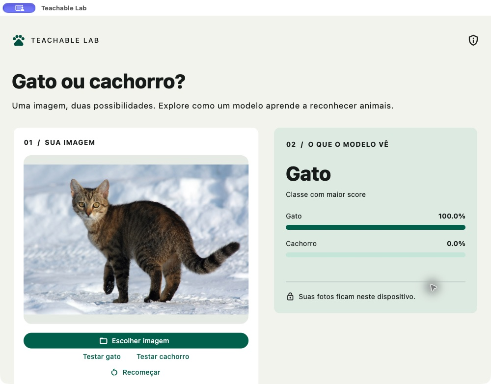

# Teachable Lab — Cat or Dog?

[](https://github.com/kleberandrade/teachable-ml-flutter/actions/workflows/ci.yml)
[](https://docs.flutter.dev/release/release-notes)
[](https://dart.dev/)
[](LICENSE)

A Flutter classroom application by **Kleber de Oliveira Andrade** that runs the original Teachable Machine cat/dog model locally. Choose your own photo or try the two licensed samples. The responsive Portuguese interface explains both class scores, handles failures and lets you start again.



*Real macOS release-build screenshot, 2026-11-17. Cat photograph: Von.grzanka, CC BY-SA 3.0. Screenshot incorporating the photo: CC BY-SA 3.0; see [sample attribution](assets/samples/README.md). Displayed percentages are rounded model scores, not measured accuracy.*

## Requirements and setup

Use Flutter **3.50.0** stable (Dart **3.14.0**), pinned in `.flutter-version`. macOS is the validated platform: macOS 12+, Xcode command-line tools and CocoaPods 1.16.2. No account, API key, hosted model or network connection is needed during classification.

```sh
git clone https://github.com/kleberandrade/teachable-ml-flutter.git
cd teachable-ml-flutter
flutter --version
flutter pub get --enforce-lockfile
flutter run -d macos
```

Choose **Escolher imagem** for a file, **Testar gato** or **Testar cachorro** for bundled samples, and **Recomeçar** to clear the current result. Cancelling the file picker keeps the previous result. Cancelling an analysis invalidates its result; the already-running isolated job may finish in the background. The interface stays responsive.

Images are limited to 12 MB and 24 megapixels. JPEG, PNG and WebP are recommended. EXIF orientation is applied before a centered square crop and resizing to 224×224. A preview shows the original aspect ratio; the model sees the square crop. Files are not uploaded or retained by this app.

## How inference works

- `lib/domain/classification.dart`: pure parsing, shape/type validation, bounded decoding, preprocessing and score interpretation.
- `lib/classifier.dart`: loads the bundled model, validates one input/output and runs each inference in a background isolate with its own native interpreter. Every job closes its interpreter, including failures.
- `lib/controller.dart`: loading, ready, busy, selection cancellation, retry, reset, stale-result rejection and disposal.
- `lib/main.dart`: responsive Material UI, live result announcements, semantic progress labels, file picker and sample controls. Android also recovers picker data after activity destruction; camera controls appear only on Android/iOS.

Model input: **float32 `[1,224,224,3]`**, RGB `(channel / 127.5) - 1`. Output: **float32 `[1,2]`**, softmax scores mapped to `0 Gato`, `1 Cachorro`, then sorted for display. Non-finite/out-of-range scores, wrong output length and a sum outside 1±0.01 are rejected. Normalization follows the Teachable Machine MobileNet convention; the old helper's `[0,1]` normalization was removed. See [model contract and limitations](docs/model-card.md).

This is a closed two-class demonstration: a chair can receive a high cat/dog score. There is no unknown class, calibrated confidence, safety guarantee or verified dataset accuracy. Two successful sample predictions are smoke tests only.

## Validate and build

```sh
dart format --output=none --set-exit-if-changed lib test integration_test
flutter analyze
flutter test --coverage
flutter test integration_test/inference_test.dart -d macos
flutter build macos --release
```

The macOS build embeds and signs the native library from the locked tflite_flutter package through an Xcode build phase. The local build is not notarized or App Store signed. CI runs the same checks and uploads the app as an artifact; the badge links to its actual status.

Verified locally: unit/controller/widget tests, native model load, real cat/dog inference, invalid-image rejection, debug/release macOS builds, and release-app UI interactions including file selection, cancellation and reset. Responsive widget layouts were checked at 360×740 and 1200×800. No Android/iOS physical-device, camera, browser or web inference test is claimed. Android license acceptance remains the user's action; the iOS native library may require a physical device. No web target is provided.

Direct packages: **material_ui 1.11.1**, **tflite_flutter 0.12.1**, **image 4.13.1**, **image_picker 1.2.4**; **flutter_lints 6.0.0**. All direct packages are current stable compatible releases. SDK/upstream transitive constraints are documented in the [dependency inventory](docs/dependencies.md), rather than forced with overrides. Installed crapper, dryer and mutator do not support Dart; no scores from them are claimed.

## Lesson and migration

Read the [Portuguese Medium lesson](https://medium.com/@kleberandrade/criando-um-aplicativo-em-flutter-para-classificar-imagens-gato-e-cachorro-com-teachable-machine-be35c604c780), [editorial record](docs/medium-update.pt-BR.md) and [action log](docs/modernization-log.md).

Version 2 replaces pre-null-safety helpers and the discontinued `tflite` API, removes `percent_indicator` in favor of native accessible progress bars, updates platform scaffolding and adds an executable macOS target. Original Android/iOS identifiers, model/labels and authorship are preserved. Historical README, architecture image links and original instructions are retained in [legacy-readme.md](docs/legacy-readme.md); they are not the current setup guide.

## Credits and licenses

Code: [MIT](LICENSE), Copyright **2020 Kleber de Oliveira Andrade**, preserved from the original README. Model and labels are unchanged original project assets; no separate model/training-data license or reproducible training archive was supplied. Do not assume the code license grants rights to the original training dataset. Teachable Machine and TensorFlow are credited to Google/their contributors.

Bundled photographs and screenshots containing them retain [CC BY-SA 3.0 attribution](assets/samples/README.md). New [cover](docs/images/cover.png) is an AI-generated conceptual illustration, not a screenshot or training image. Dependency licenses remain their respective authors' licenses; Flutter's license registry is included by the build. See [asset/model notes](docs/model-card.md).
