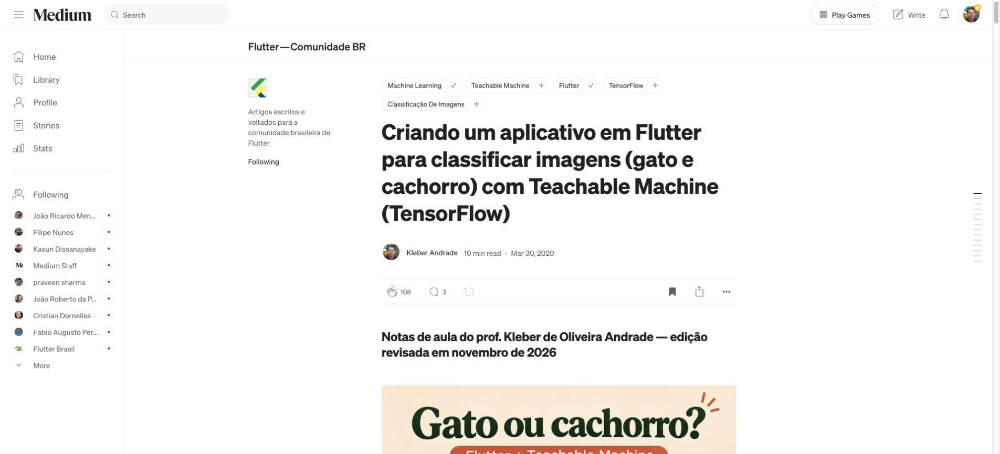
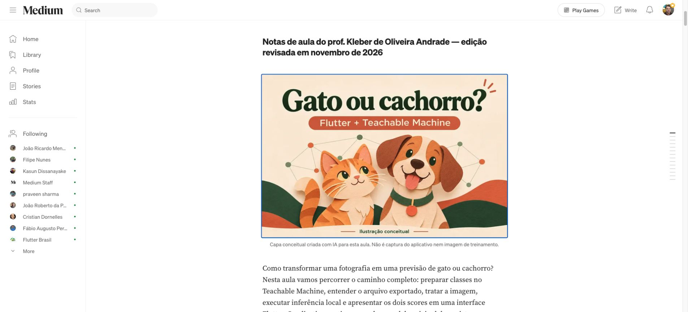
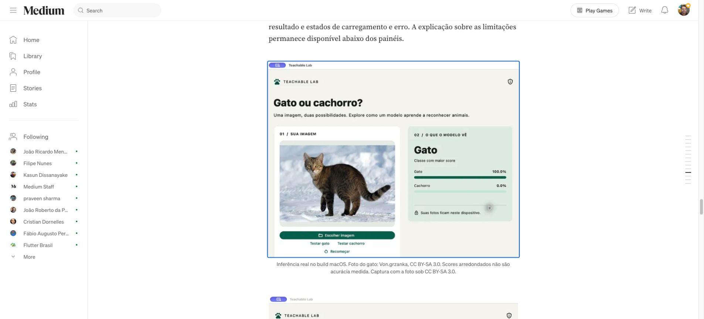
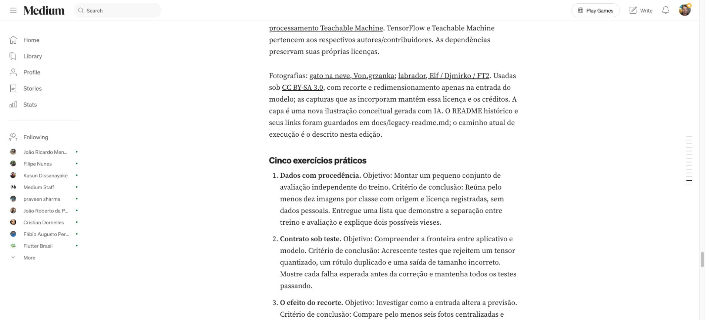

# Revisão editorial — publicada em 17/11/2026

Artigo próprio confirmado na conta **Kleber Andrade** e editado no Medium, preservando a identidade `be35c604c780`, autoria, publicação Flutter — Comunidade BR e URL original:

https://medium.com/@kleberandrade/criando-um-aplicativo-em-flutter-para-classificar-imagens-gato-e-cachorro-com-teachable-machine-be35c604c780

URL canônica após republicação:

https://medium.com/flutter-comunidade-br/criando-um-aplicativo-em-flutter-para-classificar-imagens-gato-e-cachorro-com-teachable-machine-be35c604c780

## Trabalho concluído

- Leitura do artigo real e confirmação de acesso editorial na própria conta antes de modificar.
- Revisão integral em português: contexto de classificação, preparação de dados com licença, separação de treino/avaliação, exportação float32, instalação reproduzível, dependências, arquitetura, contrato do modelo, orientação/recorte/normalização, inferência isolada, scores, ciclo de vida, recuperação, interface e testes.
- Flutter **3.50.0**, Dart **3.14.0**, material_ui **1.11.1**, tflite_flutter **0.12.1**, image **4.13.1**, image_picker **1.2.4**, flutter_lints **6.0.0**. Limites transitivos explicitados sem overrides.
- Remoção dos embeds antigos do caminho didático ativo, das instruções de APIs removidas e das alegações de acurácia histórica não reproduzida. Fontes completos estão no repositório. O conteúdo anterior foi preservado em `medium-original-editor.html` e o README histórico em `legacy-readme.md`.
- Capa nova conceitual criada com IA, explicitamente identificada como ilustração. A configuração de imagem de destaque foi aberta e confirmou a nova capa selecionada; a página pública confirmou a mesma imagem em `og:image`.
- Três capturas novas do aplicativo macOS real: estado vazio, resultado de gato e resultado de cachorro. Todas com legendas, descrições alternativas, créditos e licença das fotografias. Não há mockup apresentado como captura.
- Referências/créditos antes da última seção, que contém **exatamente cinco exercícios**, cada um com objetivo e critério de conclusão.
- Clique em **Save and publish**, retorno à página pública e verificação do conteúdo efetivamente republicado. Nenhum envio de newsletter, e-mail ou mensagem a seguidores foi realizado.

## Verificação pública

A página retornou `postPublishedType=repub`. Os sete blocos de código publicados foram comparados com os blocos do material revisado: **7/7 idênticos**, incluindo aspas, indentação e quebras de linha. Foram confirmados título/identidade, versões, sequência didática, quatro imagens carregadas, quatro descrições alternativas, quatro legendas e cinco itens na lista final de exercícios.

Capa de destaque confirmada: https://miro.medium.com/v2/resize:fit:1200/0*2THI6JZl_TxVEXfA.png

Evidência estruturada: [medium-published-verification.json](medium-published-verification.json).

Material da revisão: [medium-lesson.pt-BR.html](medium-lesson.pt-BR.html). O Medium conserva sua própria renderização; o JSON e as capturas registram a página pública verificada.

## Limites comunicados

Validação nativa e visual no macOS, builds debug/release e teste de duas amostras licenciadas. Sem teste físico de câmera/Android/iOS e sem implementação web. Os percentuais são scores de duas classes, não acurácia nem confiança calibrada. A procedência exata do conjunto de treinamento original não foi fornecida; nenhuma nova licença foi atribuída ao material de terceiros.
